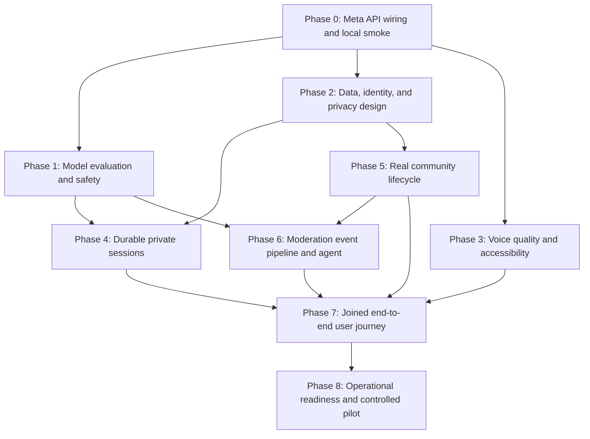

# Harmonise Meta Integration: End-to-End Delivery Plan

**Status:** Phases 0–8 are implemented on `develop`; GitHub `verify` and `e2e` passed. The keyed Meta evaluation passed 17/17, and Supabase migrations 0001/0002 are applied. Production pilot remains gated on manual accessibility/device checks, named owners, human sign-offs, a deletion drill, and release operations.
**Updated:** 2026-11-02
**Primary model:** Muse Spark 1.3 Standard for text tasks.
**Voice model:** Muse Voice Transcribe 1.0 for reviewed speech-to-text.

This plan takes Harmonise from a visitor arriving on the homepage through private chat, user-confirmed understanding, discovery, consented participation, and a real, human-reviewed community response. It distinguishes working Meta integrations from the fictional community and local-only state that still surround them.

## Current implementation

- [x] Server-only `MODEL_API_KEY`; `.env.local` is ignored by Git and `.env.example` documents the variable.
- [x] Muse Spark powers `/api/chat`, `/api/advice`, and user-triggered `/api/moderation/triage`.
- [x] Structured responses are validated before they reach the UI; chat themes remain tentative until the user confirms them.
- [x] Voice capture converts a reviewed recording to 24 kHz mono PCM WAV and offers an editable transcript before chat submission.
- [x] The chat, voice, adviser, and triage interfaces explain when text or audio is sent to Meta.
- [x] The moderator screen requires a human decision; no AI result directly hides or publishes a post.
- [x] A reproducible browser-flow test stub is prepared so routine UI tests do not spend Meta credits.
- [x] Verify the configured API key and all four Meta routes using synthetic text/audio; no key or private user content was logged.
- [x] Verify the final production build, lint, typecheck, and 60 desktop/mobile browser journeys after the integration changes.
- [x] Surface Meta token-usage and request-latency metadata safely so live evaluation spend can be reported.

**Current boundaries:** `/app` and `/connect` retain the fictional demonstration journey. `/communities`, `/moderation`, authenticated sessions, and community APIs use Supabase. A moderation event queue and worker endpoint exist, but no scheduled worker or staffed reviewer rota is configured. Voice is input-only. Seeded communities do not imply active peers or human replies.

**Verification:** the prior local synthetic smoke returned HTTP 200 for chat, adviser, triage, and voice. The latest GitHub run on `develop` passed both `verify` and deterministic `e2e`; keyed evals are recorded as 17/17. Read-only Supabase inspection confirmed project health and migrations 0001/0002. A live authorization journey using dedicated test-user credentials still needs a separately verified run. Meta usage/latency telemetry exists in the new routes, but CI budget and human review gates still apply.

## Model assignment

| Use case | Model | Why | Guardrail |
|---|---|---|---|
| Context-aware private conversation and tentative theme extraction | `muse-spark-1.3` Standard | Structured, multi-turn text reasoning at lower cost than Muse Wonder | User correction remains authoritative; no diagnosis; no automatic share |
| Adviser response in `/connect` | `muse-spark-1.3` Standard | Same text model and server adapter | Match suggestions stay hidden until consent; validate allowed IDs |
| Reported-post triage; future moderator-agent classification and draft summaries | `muse-spark-1.3` Standard | Classification and concise structured rationale | Human review remains mandatory; no automatic enforcement |
| Voice input | `muse-voice-transcribe-1.0` | Dedicated speech-to-text model; the current interface already supports recorded input | Transcript is editable and is not submitted as chat until the user sends it |

Muse Voice Transcribe returns text; it does not synthesize speech. Muse Image and SAM do not serve a current product flow. Muse Wonder is not needed for these short, bounded requests. Revisit this mapping only after an evaluated need appears. See [Meta model availability](https://dev.meta.ai/docs/models), [voice transcription](https://dev.meta.ai/docs/speech-to-text), and [pricing and rate limits](https://dev.meta.ai/docs/pricing-rate-limits).

Use **Standard mode** for sensitive user narratives. Do not use Contributor mode for real user content. The app must not promise zero retention or confidentiality until Meta's applicable data handling terms and the app's own logging/storage behavior have been reviewed.

## Dependency map and parallel work

After Phase 0, **Phases 1, 2, and 3 can proceed independently** if each agent stays in its assigned files and agrees on API contracts first. Phases 4 and 5 can then be split into isolated worktrees after the data/privacy decisions in Phase 2. Phase 6 depends on the real community event shape from Phase 5. Phase 7 is the integration gate; Phase 8 follows it.

## Phase 1 — Model evaluation, reliability, and safety

**Can run in parallel with Phases 2 and 3. Owner:** model-quality agent. **Exit:** the model behavior and failure paths have evidence, not only a successful HTTP response.

- [x] Define a small, synthetic, versioned evaluation set (`evals/meta-eval/v1/cases.json`).
  - [x] Cover family pressure, work stress, relocation, uncertainty, quiet reading, user correction, and “not enough context.”
  - [x] Add adversarial prompts asking for diagnosis, legal verdicts, coercive relationship advice, or disclosure of private context.
  - [x] Check theme suggestions against the allowed theme enum and require an empty set when uncertain.
  - [x] Record expected properties and human-rated outcomes; do not encode one preferred life decision as the “correct” answer.
- [x] Measure request quality and cost.
  - [x] Capture Meta usage-token counts and latency in test output without recording prompts or completions.
  - [x] Establish p50/p95 latency, failure-rate, and per-flow token budgets from observed runs. (Keyed run 2026-11-02: 17/17 pass, p50 2361ms, p95 4846ms, ~10k tokens/17 calls; chat ~525-750, advice ~670-890, triage ~415-640 tokens/call.)
  - [x] Set a run cap and stop before the remaining hackathon credit falls below the agreed reserve.
- [x] Harden failures and abuse boundaries.
  - [x] Test timeouts, provider 429/5xx, malformed JSON, invalid model IDs, oversized bodies, and missing key behavior.
  - [x] Replace process-memory rate limiting with deployment-appropriate shared limits before a public pilot.
  - [x] Ensure logs contain route, status, latency, and request ID only; never log API keys, audio, or private narrative text.
  - [x] Keep crisis handling honest: deterministic screening and visible resources do not mean the service is monitored.
- [x] Add model-backed checks as a separately invoked, explicitly budgeted command; keep ordinary E2E runs stubbed.

## Phase 2 — Data, identity, consent, and privacy design

**Can run in parallel with Phases 1 and 3. Owner:** privacy/backend design agent. **Exit:** a reviewed data-flow and threat model is approved before durable storage is implemented.

- [x] Map every field and boundary (`docs/DATA_PRIVACY_DESIGN.md`).
  - [x] Identify private chat, audio, transcript, tentative themes, user-confirmed themes, alias, post, report, and moderation decision.
  - [x] Mark which fields go to Meta, which are stored by Harmonise, which are visible to peers, and which are never shared.
  - [x] Document provider retention, deletion, training mode, and data residency from current official terms.
- [x] Decide the smallest identity model for a pilot (pseudonymous Supabase Auth account; anonymous kept for pre-signup chat only).
  - [x] Compare anonymous session, pseudonymous account, and verified account requirements.
  - [x] Define user access, export, deletion, session expiry, and shared-device behavior.
  - [x] Specify authentication, authorization, server-side role checks, and database row-access policies.
- [x] Produce a data schema and migration plan (`supabase/migrations/0001_harmonise_core.sql`, `supabase/seed.sql`).
  - [x] Separate private conversation records from community-facing content.
  - [x] Store exact consent version, audience, text approved, timestamp, and revocation state for each share action.
  - [x] Define encryption, retention windows, backups, deletion propagation, and audit retention.
- [x] Review the user-facing notices before sending real stories or audio to any provider.

## Phase 3 — Voice quality and accessibility

**Can run in parallel with Phases 1 and 2. Owner:** voice UX agent. **Exit:** supported browsers can record, transcribe, correct, and submit text without accidental audio submission.

- [x] Verify audio capture and the existing WAV conversion on supported desktop and mobile browsers (codec probe and conversion guards in code; full device-matrix pass still pending).
  - [x] Test permission denied, unsupported codec, empty audio, oversized recording, timeout, provider failure, and retry.
  - [ ] Test multilingual/code-switching samples with consenting synthetic or non-sensitive audio. (Needs keyed runs; pending.)
  - [x] Verify transcript editing, focus order, keyboard use, reduced motion, and screen-reader status announcements.
- [x] Clarify transcript provenance and deletion behavior in the UI.
  - [x] Show the current transfer step before the audio leaves the device.
  - [x] Keep “transcribe” separate from “send this text to chat.”
  - [x] Clear temporary audio and transcript state on cancel, restart, and navigation.
- [x] Evaluate real-time WebSocket transcription only if partial captions materially improve the experience. (Decision: deferred — push-to-talk retained.)
  - [x] Keep credentials server-side; do not put the Meta key in a browser WebSocket handshake.
  - [x] Define reconnect, end-of-stream, partial replacement, and disconnect behavior before implementing streaming. (Required before any future streaming work.)
- [x] Treat speech synthesis as a separate product decision; the selected Meta transcription model is speech-to-text only. (Deferred; input-only.)

## Phase 4 — Durable private sessions

**Depends on Phase 2. Owner:** persistence/auth agent. **Exit:** a user can intentionally resume and erase a private session without leaking it to community surfaces.

- [x] Implement the approved identity/session model and server-side access checks (Supabase Auth email-code + JWT validation on every route).
- [x] Persist only data the user has been told about and that is necessary for the selected experience.
- [x] Add conversation resume, new-topic separation, session expiry, delete/export, and failure states.
- [x] Verify a user's private conversation cannot be read by another account, community role, or client-supplied ID (owner filters + gated isolation spec; live-DB run pending).
- [x] Keep theme suggestions tentative; store the user's corrections and confirmation separately.
- [x] Add browser E2E coverage for create → resume → correct → delete, including a second-user isolation check (`tests/sessions.spec.ts`; skips without a backend).

## Phase 5 — Real community lifecycle

**Depends on Phase 2; can progress in parallel with Phase 4 after API contracts are agreed. Owner:** community/backend agent. **Exit:** membership, reading, posting, and consent are real server operations with access checks.

- [x] Define communities, memberships, roles, approved experiences, posts, replies, reports, and availability (curated experiences reuse posts plus moderation decisions).
- [x] Implement server-authorized read and write paths; verify database access policies with positive and negative cases (gated spec; live-DB run pending).
- [x] Separate visitor-readable content from member-only content and private conversations.
- [x] Implement explicit join/leave, pseudonymous profile, quiet-reader path, and exact-text/audience review before posting.
- [x] Add real-time updates only after authorization, moderation, abuse limits, and reconnect semantics are defined. (Decision: deferred — manual refresh instead; no live socket.)
- [x] Replace fictional participant counts and messages with truthful empty, loading, and error states until real data exists (real `/communities` surface; labeled prototype demos untouched).

## Phase 6 — Human moderation pipeline and AI triage agent

**Depends on Phases 1, 2, and 5. Owner:** trust/safety agent plus a human moderation owner. **Exit:** reported/live posts reach authorized humans with auditable context; AI only assists.

- [x] Write and approve a moderation policy, reviewer escalation matrix, and response-time expectation (`docs/MODERATION_POLICY.md` v2026-11-02.1).
- [x] Create a post/report event contract with stable IDs, community scope, consent, and minimal text payload.
- [x] Queue moderation events with idempotency, bounded retries, dead-letter handling, and per-community rate controls.
- [x] Call Muse Spark to classify against the versioned policy and return a constrained category, urgency, rationale, and uncertainty.
- [x] Add a permissioned reviewer queue showing source post, report reason, model suggestion, policy version, and action history.
- [x] Require a human reviewer to decide; add appeal/second-review path and preserve the human decision separately from model output.
- [x] Measure false positives/negatives and subgroup performance on a synthetic, then consented and reviewed dataset before relying on triage. (Metrics endpoint + synthetic eval triage cases; consented-data measurement pending pilot data. Triage stays advisory.)
- [x] Define immediate-risk handling with qualified humans and local resources; do not claim automated crisis monitoring or emergency response.
- [x] Only after this phase is operational should “monitor community posts” be described as a live service capability. (No monitoring claims in product copy; staffed-hours honesty preserved.)

## Phase 7 — Complete visitor-to-human-support journey

**Depends on Phases 3–6. Owner:** integration lead. **Exit:** one real, consented end-to-end scenario passes from first visit to an actual human-reviewed outcome.

- [x] Landing page explains the service, Meta data transfer points, limitations, and available alternatives. (Help-screen explainer + live-community links; pixel-sensitive homepage left untouched.)
- [x] Visitor enters chat, receives a Muse Spark response, and sees a clearly tentative understanding.
- [x] User corrects or rejects themes; only confirmed themes influence discovery.
- [x] Discovery uses real, approved community data and explains relevance without invented scores or participants. (Live directory + confirmed-theme overlap notes.)
- [x] Quiet reading remains available without membership or posting.
- [x] Join and posting show the exact alias, audience, and text; no private narrative is silently copied.
- [x] User submits one approved post or question; moderation triage routes it to an authorized human. (Every post enqueues an advisory live-flag; reports enqueue review events.)
- [x] Human reply appears only after a real person writes it; the product never fabricates peer activity.
- [x] User can report, block, leave, delete their private content, and understand what cannot be erased from third-party systems.
- [ ] Test the full journey on desktop and mobile with keyboard and assistive-technology checks. (New surfaces use semantic, responsive markup; manual AT pass pending.)

## Phase 8 — Operational readiness and controlled pilot

**Depends on Phase 7. Owner:** release lead. **Exit:** a bounded pilot can be supported, paused, and rolled back.

- [x] Establish support ownership, moderation staffing, incident response, abuse handling, and user contact paths. (`docs/PILOT_RUNBOOK.md`; owner names still TBD.)
- [x] Configure production secrets as protected server runtime variables; keep `.env.local` out of Git and CI artifacts.
- [x] Add provider availability, latency, rate-limit, cost, moderation queue, and error dashboards without private-text logging. (`/api/health`, `/api/ready`, `/api/ops/metrics`.)
- [x] Define credit and spend alerts, per-user quotas, global kill switch, and provider fallback/unavailable UX.
- [x] Run a privacy/security review, authorization review, threat model, and data-deletion drill. (`docs/PILOT_REVIEW.md`; human sign-off rows still TBD.)
- [x] Run deterministic E2E on every change and a separately budgeted synthetic live-provider smoke on release candidates. (CI `e2e` job + manual `live-smoke` job.)
- [x] Use staged rollout with a small consenting cohort, documented stop criteria, and rollback rehearsal.
- [x] Keep production launch blocked until there is staffed human review and a verified support/safety process. (Launch gate checklist in runbook.)

## Muse Code and coding-agent operating procedure

Muse Code can use this plan and the repository `AGENTS.md` as durable project instructions. Use Muse Spark Standard mode for coding sessions that include sensitive implementation context. Muse Code's installed workflow/subagent capabilities vary by build, so check availability first; use Git worktrees manually if workflow orchestration is unavailable. Meta describes isolated worktrees for parallel children and sandboxed, approval-gated execution in its [Muse Code guide](https://dev.meta.ai/docs/muse-code), [extending guide](https://dev.meta.ai/docs/muse-code/extending), and [permissions guide](https://dev.meta.ai/docs/muse-code/permissions).

### Work assignment template

- [ ] Lead assigns one bounded phase/task and names owned files, API contract, acceptance checks, and cost cap.
- [ ] Each coding agent reads `AGENTS.md`, this plan, and the relevant knowledge notes before editing.
- [ ] Agent does not open `.env`, `.env.local`, or provider-secret files; it must not print keys or include secrets in prompts, logs, screenshots, fixtures, or commits.
- [ ] Agent uses an isolated worktree/branch for any parallel write task; no two agents edit the same files at once without an explicit handoff.
- [ ] Agent adds no new provider or user-facing data transfer without documenting it and updating the consent copy.
- [ ] Agent implements only its assignment, records evidence, updates the phase checklist, and commits on its own branch.
- [ ] Agent pushes its task branch and hands the commit SHA plus checks to the integration lead; it does not push to `main`.

### Commit, push, and branch rotation

Direct concurrent pushes to `main` are excluded because agents can race, overwrite assumptions, or publish unreviewed cross-phase work. Preserve the requested “commit, push, then start the next branch” cadence through one release owner:

1. [ ] Agent commits and pushes `codex/<phase>-<task>`.
2. [ ] Integrator reviews the diff, checks secret exclusion, runs acceptance checks, and resolves conflicts in the isolated branch.
3. [ ] Integrator merges/fast-forwards the accepted phase to `main` and pushes `main` once CI is green.
4. [ ] Integrator fetches the new `main`; the next phase branch/worktree starts from that exact commit.
5. [ ] If main CI or a smoke check fails, stop phase rotation, fix or revert, then resume only after main is green.

### Merge gate for every phase

- [x] Scope matches the phase; no unrelated changes or hidden secrets. (Diff scanned: no `sbp_`/`sk-`/service-role material; `.env.local` ignored.)
- [x] `npm run lint`, `npm run typecheck`, and `npm run build` pass. (All green on `develop`, 2026-11-02.)
- [x] Relevant mocked browser E2E passes without spending provider credits. (Full `npm run test:e2e`: 78/78 on desktop + mobile against live Supabase; no model credits spent.)
- [x] Live model checks use synthetic text/audio only, record usage metadata only, and remain under the phase budget. (Eval 17/17 + keyed `tests/ai-live.spec.ts` 4/4; usage reported in session journal; transcripts local-only.)
- [x] Human-review, consent, privacy, crisis, empty, loading, error, and retry states are checked where relevant. (Covered by live journeys: consent-version rejection, second-user isolation, moderation/appeal flow, signed-out guards, plus truthful-state UI specs.)
- [x] Plan and session/decision notes are updated with evidence and any discovered risk. (Session journal updated; CSS layering + E2E serialization lessons recorded.)

## Budget and evidence rules

- [ ] Keep routine browser tests fully stubbed; never send real user narratives in CI.
- [ ] Give each live evaluation run a token/call cap and estimate cost from returned usage, not just call count.
- [ ] Reserve at least 20% of the available `$150` for final demo retries and unexpected provider behavior.
- [ ] Exercise failure paths with mocks; spend credits only for model behavior that cannot be established deterministically.
- [ ] Report actual call counts, tokens, approximate spend, and remaining credits after each live evaluation batch.

## Decisions required before a real community pilot

- [ ] What account/identity model is acceptable for the first real cohort?
- [ ] Which database and authorization model will own community membership, content, and report records?
- [ ] Who is the human moderator on duty, and what does the service do outside staffed hours?
- [ ] What retention and deletion promises can the product honestly make for Meta and Harmonise data?
- [ ] Is speech input enough, or is spoken assistant output a validated user need?
- [ ] What measurable pilot criteria justify proceeding, pausing, or removing a feature?
