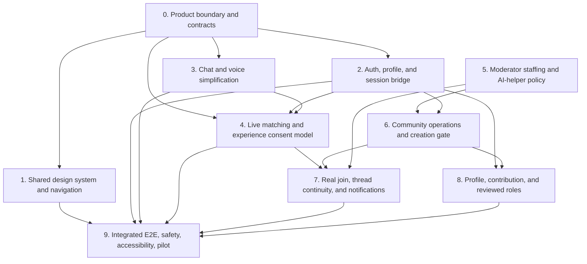

# Harmonise — End-to-End Product Journey and Gap Plan

**Audit date:** 2026-11-02
**Status:** Product and UX planning, with implementation progress tracked in the checkboxes below.
**Purpose:** Give product, design, backend, safety, and implementation owners one checklist for turning the current split experiences into one simple, honest, working journey.

## 1. Product goal

Help a person move from a private thought to a useful next step, then—only if they choose—into a relevant, real peer community where they can read, participate, and receive a human response when one is available.

The intended journey is:

1. A visitor understands what Harmonise does and can begin without facing a large menu.
2. They start a private conversation by typing or speaking naturally.
3. The assistant remembers the conversation, reflects a short tentative understanding, and lets the person correct or skip it.
4. Harmonise recommends at most a few relevant communities and, when available, one consented lived-experience story. It says why each may fit and what the person can expect there.
5. The person can preview, join with a community-only alias, or keep browsing. Their private conversation is never copied into a community.
6. They can read previous community threads, reply or start a post after reviewing its audience, and understand that a peer reply is not guaranteed unless a staffed response service says otherwise.
7. A real human moderator is assigned and operating for every live community. A clearly labelled AI helper may support routine tasks; it does not pretend to be a peer, make enforcement decisions, or replace human coverage.
8. Over time the person can see community-scoped contribution milestones. Meaningful participation is enough for ordinary contributor levels; human-reviewed verification is a separate, optional capability behind `COMMUNITY_ROLE_VERIFICATION_ENABLED` (default `false`). Activity never implies clinical skill, trustworthiness, or professional status.

## 2. Audit status: what is real today

The largest integration gap is that the desired journey crosses three different products with three different data lifetimes:

| Surface | What it does today | What it does not mean |
|---|---|---|
| `/` | Public story-led homepage, rendered from a separate static HTML document in an iframe. Its primary demo CTAs lead to `/connect`. | It is not a shared application shell or shared design-token implementation. |
| `/app` | Long, fictional guided story with a live Muse Spark chat route when configured, tentative understanding, sample stories/discussions, local scenario flows, voice transcription, and optional saved sessions for authenticated users. | Its story, peer interactions, and scenario moderator actions are not real community activity. It is not the same journey as `/connect`. |
| `/connect` and `/connect/member` | Public shared demo credential form, live Meta Adviser calls, AI-suggested sample circles, and local demo tabs for journey, circles, and coaches. | Demo sign-in is not authentication. Profile, messages, joins, posts, reactions, and points remain in browser memory; they do not become live memberships or posts. |
| `/communities` and `/communities/[id]` | Supabase-backed directory, memberships, aliases, posts, replies, reports, blocks, and leave flow. Members can review exact post/reply text and audience before sharing. | The directory is not connected to `/app` or `/connect` chat context. It has no live reply notifications, real-time feed, or response-time promise. |
| `/moderation` | Supabase-backed, permissioned human reviewer queue, reports, AI triage suggestions, human decisions, and appeals. | It is not continuously staffed or scheduled. AI triage is advisory; there is no autonomous moderator/member in each community. |
| `/api/voice/transcribe` | Server-side Muse Voice Transcribe endpoint with validation/limits. The voice UI is currently in `/app`. | `/connect` has no voice input. Voice is not speech synthesis or live streaming. |

Evidence: `/app` routes through [product-route.tsx](../src/components/product-route.tsx) and its local/fictional screen flow is in [harmonise-experience.tsx](../src/components/harmonise-experience.tsx). `/connect` demo state is in [session.tsx](../src/lib/connect/session.tsx), with Meta advice in [adviser.tsx](../src/components/connect/adviser.tsx). Live communities use [real-community-detail.tsx](../src/components/community/real-community-detail.tsx) and server routes under `src/app/api/communities`. The human review queue is [reviewer-queue.tsx](../src/components/moderation/reviewer-queue.tsx).

### Current foundation already implemented

- [x] Meta Muse Spark is called from server routes for chat/advice and advisory moderation triage; the model key stays server-side.
- [x] Muse Voice Transcribe is integrated as speech-to-text, with recording disclosure, review, size limits, and error handling.
- [x] Supabase Auth, private sessions, session understanding, live community membership, posts/replies, reports, blocks, moderator roles, decisions, and appeals have backend code and migrations.
- [x] Community post/reply publishing requires an exact-text and audience review step.
- [x] Community content can be reported; AI triage does not decide or enforce moderation actions.
- [x] The homepage has a demo route, and `/connect` offers shared demo credentials for a no-setup walkthrough.
- [x] A synthetic demo browser journey covers sign-in → chat → reveal match → join circle on desktop and mobile.

### Current foundation still requiring operational proof

- [ ] Complete a live authorized-user browser run from `/app` chat through Supabase identity, private-session resume, live community join, post/reply, report, moderator decision, and user-visible outcome. Existing deterministic E2E does not prove that cross-surface journey.
- [ ] Verify deployed Auth email-code delivery, sender configuration, rate limits, and account recovery with non-staff test accounts.
- [ ] Name moderators, define their coverage windows and response expectations, and verify escalation contact paths before any “human moderators” availability claim.
- [ ] Monitor the daily Vercel Hobby moderation worker. It handles one queued event per call and is not continuous; add backlog recovery/alerting and named coverage before a public pilot.
- [ ] Replace optional process-local rate limits with a shared store before a multi-instance/public pilot.
- [ ] Finish a manual mobile, keyboard, screen-reader, contrast, reduced-motion, and microphone-permission review on the unified journey.

## 3. Page-by-page product critique

This is a source-based audit of existing screens, not a claim that every route was exercised against production data.

### 3.1 Homepage `/`

**Today:** A calm, animated story page with illustrations and clear emotional framing. It is a standalone HTML document embedded in an iframe. Its demo CTA currently sends visitors to `/connect`.

**Friction / gap:** The route presents the Harmonise story, but a visitor then lands in a distinct app with another wordmark treatment, separate tokens, a lengthy sign-in explainer, and a demo-only limitation. The jump makes the product feel like a prototype transition. The iframe boundary also means application navigation, focus handling, typography and motion cannot share a single app shell automatically.

- [ ] Decide the single primary CTA and target: **Start privately** should enter one canonical chat journey; keep “Explore lived experiences” as a quieter alternative.
- [ ] Add one short “what happens next” sentence: private chat → optional matching → user-controlled join.
- [ ] Place the Meta data-transfer notice at the point of chat/voice use, not as a dense preamble on the homepage.
- [ ] Make the homepage and product app share one navigation/brand source and the same responsive/focus behavior, even if the marketing document remains isolated.
- [ ] Check that all desktop/mobile CTA variants, mobile menu, footer CTA, keyboard focus, reduced motion, and iframe-to-app focus/scroll behavior land correctly.
- [ ] Avoid asking for account creation before the visitor has seen enough value; explain when a real account becomes necessary to save or join.

### 3.2 First-use entry and identity (`/app`, `/connect`)

**Today:** `/app` begins with a fictional Arjun story and offers **Start privately** or **Explore lived experiences**. `/connect` offers a public shared demo email/password and enters a local “Quiet Fern” demo. Live communities use a separate email-code AuthCard when joining or saving.

**Friction / gap:** Three entry/identity models coexist: fictional story, local shared demo credentials, and real Supabase account. The shared password is intentionally public and must never be mistaken for secure access. The real login is deferred until a save/join task, which can surprise someone after they have already shared a personal story.

- [ ] Choose one canonical visitor path and state its privacy mode before the first message: temporary/local chat or saved account chat.
- [ ] Keep “Try the demo” visibly labelled as a demo; keep it out of real account and live-membership claims.
- [ ] Define optional sign-up timing. Recommended: allow a clearly temporary private first conversation, then request account authentication only when the user chooses **Save**, **Join**, or another persistent action.
- [ ] If temporary chat can be carried into a new account, ask whether to import it and show exactly what will be saved. Default to no import.
- [ ] Add a stable user profile with separate private identity and per-community aliases; do not expose email or cross-community identity.
- [ ] Make code resend, expiry, invalid code, changed email, lost session, sign-out, shared-device exit, and account recovery understandable and recoverable.
- [ ] Remove the shared demo credential when the live journey replaces `/connect`; until then mark the mode as fictional in the UI and documentation.

### 3.3 Private chat and voice (`/app`; currently split from `/connect`)

**Today:** `/app` sends messages to `/api/chat`; up to eight preceding turns are included. It renders conversation bubbles plus a large repeated “Have I got this right?” context panel, suggested themes, support intent, confirmation/correction actions, and several follow-up routes. An authenticated session can be saved/resumed. `/connect` uses `/api/advice` and has a separate adviser UI with reflection, steps, perspective, and matching controls. Only `/app` has voice.

**Friction / gap:** Too much explanatory/support content competes with the conversation. Repeating a large analysis panel after turns interrupts the chat. The voice workflow requires multiple decisions after recording and makes the user move the transcript back into the composer before sending. `/connect` and `/app` do not share a chat component or history.

- [ ] Make the transcript the visual centre: compact user/assistant bubbles, one persistent composer, and one visible voice button beside Send.
- [ ] Keep a small typing indicator and retry-in-place state. Keep the user's unsent draft when an API call fails.
- [ ] Replace the large repeated panel with one compact optional line (“I think the main issue is …”) and **Yes / Edit / Skip**. Expand detail only when asked.
- [ ] Keep community discovery optional and distinct from private advice. Do not repeat privacy/safety/legal copy under every message.
- [ ] Preserve the whole conversation in a scrollable thread; keep the composer available and return focus correctly after a response.
- [ ] Provide clear **New chat**, **Resume**, and **Delete** controls for real saved conversations. Indicate whether the current conversation is temporary or saved and its expiry.
- [ ] Define what conversation context the model sees, how many turns are sent, and when a new topic stops inheriting earlier context.
- [ ] Add short example prompts only for an empty conversation; remove them after the first send.
- [ ] Add an interrupt/cancel control for slow model requests and prevent duplicate submissions.
- [ ] Evaluate concise answer defaults: short reflection, one practical next step, optional “More detail” disclosure. Avoid therapy/diagnosis claims.

**Lower-friction voice target:**

- [ ] Put a mic button in the same composer row as text input and Send.
- [ ] First-use disclosure explains that tapping the mic starts local recording, and stopping sends audio to Meta Voice for transcription. Do not imply audio is “not sent” after the user initiates transcription.
- [ ] While recording, show a clear active microphone state, elapsed time, waveform/level feedback, and obvious **Stop** and **Cancel** actions; stop tracks on every exit path.
- [ ] On Stop, transcribe once (no separate “ask it to transcribe again” button), then place the editable transcript directly in the composer.
- [ ] The user can edit, send, retry, or discard the transcript. Never auto-send recognized text to the conversation.
- [ ] State whether audio is retained locally or server-side and for how long; verify provider terms before making retention promises.
- [ ] Cover denied permission, muted/empty input, unsupported browser, codec/conversion failure, silence, language/code-switching, long clip, timeout, provider busy, and retry without losing typed draft.
- [ ] Keep typing usable on every voice failure; never require microphone access to continue.

### 3.4 Understanding and intent confirmation (`/app`)

**Today:** Muse Spark returns tentative themes, need type, and a summary. The UI includes the last user message, suggested themes, a need summary, confirmation, correction choices, and next-step options. Confirmed themes are separate from suggested themes in the database.

- [ ] Keep this user correction authority; never let model inference silently become a profile trait or community post.
- [ ] Confirm the problem in one plain-language sentence, not a questionnaire. Let the user edit the sentence inline or skip matching.
- [ ] Ask a follow-up only when it materially improves the match; accept “I’m not sure.”
- [ ] Make “not for me” immediately change results and carry that correction into the next model/matcher request.
- [ ] Store only the minimum confirmed context needed for matching, with an understandable edit/delete affordance.
- [ ] Prevent sensitive inferences and crisis content from being used to rank people or communities.
- [ ] Keep the current `suggested` vs `confirmed` distinction in backend schemas, authorization, logs, and UI.

### 3.5 Discovery and relevant lived experience (`/app`, `/connect`, `/communities`)

**Today:** `/app` has fictional contributor stories and discussion fixtures, with a local context comparison. `/connect` asks the Muse adviser to return known sample-circle IDs and a short fit reason. `/communities` lists live community name, description, counts, visibility, and optional broad overlap with confirmed theme query parameters. The live schema stores posts/replies but has no curated lived-experience/story object or public-contributor consent lifecycle.

- [ ] Build one live matching contract from user-confirmed themes and a curated set of approved community topics; use structured filters first and model ranking only as a bounded, explainable aid.
- [ ] Return a small result set: one strongest match, up to two alternatives, or an honest no-match state.
- [ ] For each result show: one-sentence **Why this may fit**, **What happens there**, visibility/membership requirement, current activity freshness, and whether people are available to reply (only if measured/operated).
- [ ] Show one relevant lived-experience card at the top when a real, consented, approved story exists. Label it as a member’s shared experience, not advice or a guarantee of a personal reply.
- [ ] Create a consented experience model: exact approved summary, topics, alias/attribution preference, audience, expiry/review date, discoverability toggle, and revocation that unlists it.
- [ ] Never use raw private conversation as a story-search query sent to other users or as public story content. Match on user-confirmed minimal themes; ask before using anything else.
- [ ] Give **Why this?**, **Not relevant**, **Show another**, and **Keep chatting** controls. Explain the reason without a numeric “match score.”
- [ ] Link the card to its real community/story and preserve the confirmed match context through sign-in. Do not route a live recommendation into a fictional circle.
- [ ] Make empty, loading, model unavailable, no relevant story, no communities, and stale-content states distinct.
- [ ] Measure recommendation quality with consented/synthetic evaluations; track user corrections, not just click-through or join conversion.

### 3.6 Community detail and post-join journey (`/communities/[id]`)

**Today:** Authenticated members can join with a community-specific alias, read posts, expand replies, write an exact-text-reviewed post or reply, report, block an author, delete their own post, and leave. This is persisted. The feed uses manual refresh and ordinary threads rather than real-time group chat. No notifications or reply-time expectation is present.

- [ ] Preserve the useful safety control: show alias, audience, exact text, and consent version before each post or reply.
- [ ] Make the landing state after joining an orientation, not a blank feed: purpose, rules, who moderates and when, one gentle first action, and a clear quiet-reading option.
- [ ] Make **Read and reply** open an in-context thread with prior replies, reply composer, author alias, and report/block controls.
- [ ] Let a member return to their own previous posts, replies, and joined communities from a simple **Your activity** area.
- [ ] Add a reply notification/inbox and user-controlled email/push preferences. Keep notification previews private by default and avoid sensitive excerpts on lock screens.
- [ ] Until notification and staffing service levels exist, say plainly: “Replies may take time; no response is guaranteed.” Do not imply somebody is online or available from member count alone.
- [ ] Add new-reply state, unread count, and refresh behavior. Decide whether to use Supabase Realtime only after auth, row-level access, reconnect, duplicate, and offline behavior are specified.
- [ ] Define editing/deleting a post and reply, moderator-held content feedback, report status visibility, appeal access, and what deletion cannot remove (e.g. copies already sent to Meta or backups subject to policy).
- [ ] Explain what others can see before joining: community name, purpose, visibility, activity counts; never expose member-only content to a signed-out person.
- [ ] Make leave, block/unblock, and notification pause discoverable without putting destructive controls next to the send action.

### 3.7 Community directory and no-match state (`/communities`)

**Today:** This is a separate live directory with loading/unavailable/error/empty states and real counts. It has a “Suggest a community” path when no current space fits, but it does not receive confirmed chat context or show match explanations/stories from the assistant.

- [ ] Unify directory and chat discovery data and use the same community cards, names, privacy labels, and match reasons.
- [ ] Add topic browsing and basic filters, plus a non-personalized browse path.
- [x] Offer a truthful no-match path: browse current communities or suggest a future group with fresh purpose text.
- [x] Do not let the AI publish or populate a community just because no result matched. A user opts in to a private proposal; no personal narrative is copied; a human owner reviews launch.
- [ ] Before opening any new community, require a named human moderator/owner and coverage plan. A new group with no human coverage must remain waitlisted or closed.

### 3.8 Community creation and moderator-agent behavior

**Today:** A signed-in member can suggest a private community; a service-role transaction creates a pending record and host membership, and a database trigger provisions a unique per-community AI helper. An allowlisted human reviewer sees a proposal queue and must attest to coverage before approval. Pending communities cannot be joined or posted to. `/connect` circles remain a separate sample presentation.

- [x] Decide and document who may propose and approve a community; approval requires an allowlisted reviewer and coverage attestation. Pause/merge/close authority remains open.
- [ ] Define minimum launch gate: purpose and boundaries, community owner, trained human moderator coverage, escalation contact, content policy, member safety controls, and an honest expected-response statement.
- [x] Add a user-approved private proposal path with an owner; no private chat is copied. Proposal is not an automatically published group.
- [x] Decide the constrained AI role: per-community **AI community helper** config supplies public purpose/topics to advisory triage and flags queued content for human review. No FAQ replies, scheduled prompts, or summaries are enabled.
- [x] Identify the helper as AI and state its limits; do not present it as a lived-experience peer or human coverage.
- [ ] Keep enforcement (remove, hide, ban, crisis contact) with authorized humans. Require human moderator ownership and coverage in every live group.
- [x] Limit helper input to queued community-visible content plus that community’s public purpose/topics; no private chat/session, hidden profile, or unsent drafts.
- [ ] Define any future posting cadence/opt-out, evaluation and outage details. Current helper does not post or send prompts; triage attribution is stored in the reviewer path and the existing kill switch applies.
- [ ] If a community has no human moderator available, pause new joins/posts or show the actual coverage state; do not imply the AI provides human safety coverage.

### 3.9 Profile, helpful participation, volunteer/trainer progression

**Today:** `/connect` still shows fictional in-memory points and sample aliases. In live `/communities/[id]`, members see a private community-scoped activity summary derived from visible unique posts/replies. “Contributor” starts at 3 qualifying contributions across 2 UTC days; “Community regular” starts at 10 across 5 days. Demo-only sample profiles are labeled and never inserted as Auth users. Human-reviewed role labels are behind `COMMUNITY_ROLE_VERIFICATION_ENABLED=false` by default. A complete role application, training, evidence, and renewal workflow does not exist.

- [ ] Decide what a member profile is for and what remains private. Start with a private activity history; only reveal an alias/profile field when the member opts in.
- [x] Prefer transparent, community-scoped contributions and earned acknowledgements over a global score or leaderboard. A score can incentivize oversharing, popularity contests, brigading, and unfair treatment.
- [ ] Never reward sensitive disclosure, distress, time spent in crisis areas, or agreement with an AI. Do not make “good enough” a model decision.
- [x] Define a modest activity signal without evaluating text meaning: visible posts/replies need 20 trimmed characters, normalized duplicate text counts once, and held/removed content does not count.
- [ ] Let members inspect, hide, correct, contest, or remove eligible reputation/activity records. Define retention and moderator audit exceptions.
- [ ] Separate roles: lived-experience contributor, trained peer listener, community moderator, professional provider, and trainer. These roles have different competence, scope, and verification needs.
- [ ] Build an opt-in volunteer application, manual review, identity/credential checks appropriate to the role, training, safeguarding scope, supervised period, expiry/recheck, suspension, and appeal process.
- [ ] Show what “verified” means, who verified it, what scope it covers, and when it expires. Never infer or grant verification from points or model output.
- [ ] Make participation non-coercive: joining, posting, disclosing a personal story, and applying to volunteer remain separate choices.

### 3.10 Saved sessions, profile access, and account management

**Today:** `/app` can use the email-code AuthCard and saved-session panel when the database is enabled. Private sessions/messages have a 90-day inactivity expiry. Export, delete, and sign-out APIs/UI exist. `/connect` does not use these services.

- [ ] Bridge the unified chat to the existing session APIs and confirm which states (messages, suggested/confirmed understanding) are saved and for how long.
- [ ] Ensure session creation, message save, response save, and conversation title do not silently fail or lose the user’s typed text.
- [ ] Add a clear saved/temporary status and last-saved indicator; disclose if a provider response arrives before persistence succeeds.
- [ ] Test resume on a second device, expired session, delete, export, sign-out, shared-device cleanup, and cross-user access denial.
- [ ] Decide and display how deleting an app session relates to copies sent to Meta and to community posts separately shared by the user.
- [ ] Add account/profile settings for alias, communication preferences, privacy controls, and data export/delete only when every setting has a real backend effect.

### 3.11 Safety and urgent support

**Today:** The app has user-triggered crisis routing/resources, explicit limitations, report/block flows, and reviewer escalation foundations. It also says messages are not monitored and the service cannot contact emergency services. These honest boundaries must be preserved.

- [ ] Keep urgent support reachable from the chat composer/header and community thread without interrupting ordinary conversation.
- [ ] Verify all geographic resources and localize by user-selected region; do not assume India solely from a default example.
- [ ] Distinguish “AI safety suggestion,” “report submitted,” “human reviewed,” and “emergency contact” states. Never conflate them.
- [ ] Agree staffed hours, response-time targets, out-of-hours copy, escalation owner, safeguarding process, and incident response before offering monitored support.
- [ ] Keep model responses non-diagnostic and non-directive; route high-risk cases to reviewed resources without claiming a human has been alerted unless that notification actually succeeded.
- [ ] Review misuse scenarios: stalking via alias, re-identification, coercive family access to shared devices, spam, brigading, harassment, evasion, moderator abuse, and malicious prompt injection in posts.

### 3.12 Moderator review (`/moderation`)

**Today:** Reviewer login/assignment checks, reports, advisory flags, queue, AI suggestions, human decisions and appeals exist. The page combines several kinds of work in one screen. A daily Vercel Hobby cron processes one queued event per invocation, but human staffing and continuous coverage are missing; reviewer API failure can resemble an empty state in some paths.

- [ ] Make queue load/error/empty/retry states impossible to confuse; failed metrics or flags must not quietly look like zero activity.
- [ ] Add priority, age/SLA, community, case status, and clear next action. Provide a case detail view with relevant context and an audit trail.
- [ ] Keep AI suggestion, uncertainty, policy version, and human decision visually separate. Require a human rationale where policy calls for one.
- [ ] Add reporter/author receipt and status/outcome notifications with only audience-appropriate details.
- [ ] Implement and rehearse schedule, one-event worker drain/retry/dead-letter alerts, backoff, idempotency, concurrency control, and recovery.
- [ ] Assign named reviewers per group, define coverage and backups, and confirm the rota is actually active.
- [ ] Test appeal deadlines, conflict of interest, second reviewer, recusal, moderator abuse, false reports, and no moderator available.
- [ ] Add reviewer ergonomics: keyboard-first case navigation, mobile-safe controls, minimized unnecessary narrative exposure, and clear previous/next case.
- [ ] Retain AI as advisory triage only until evaluation and operational evidence explicitly supports any expanded capability.

### 3.13 Support coaches and connections

**Today:** `/connect` has a coach preview built from sample data; `/app` has fictional connection-request screens and says no real person was contacted. Professional listings are not verified or bookable.

- [ ] Decide whether direct peer connections are part of MVP. Group-only is the safer initial default for sensitive support.
- [ ] If enabled, create a persisted mutual opt-in request with group/private boundary, block/report, expiry, and consent on both sides.
- [ ] Separate peer lived experience, trained listener, coach, moderator, and licensed professional labels and scopes.
- [ ] Do not list real providers or imply credentials/availability until credential review, booking/contact, complaints, and suspension workflows exist.
- [ ] Remove fictional coach/connection controls from the canonical app path or label them as a separate demo.

## 4. Cross-cutting UX and design-system improvements

- [ ] Choose one shared design-token source for paper, ink, coral, peach, lilac, blue, sage, warm line, focus, typography, radii, shadows, and motion. The homepage is a separate static HTML/iframe; `/app` uses global tokens; `/connect` defines a parallel forest/charcoal token set.
- [ ] Keep the homepage's calm editorial hierarchy and wordmark geometry, but make product screens more compact: one clear heading, one primary action, one short explanation, progressive disclosure for the rest.
- [ ] Standardize typography loading, heading scale, body copy length, line width, button height, card radius, icon style, empty/error states, and focus treatment across all routes.
- [ ] Use purposeful illustrations only where they orient the user; do not place large decorative/educational panels beside every functional chat view.
- [ ] Prefer inline, reversible feedback and short motion that signals progress. Respect `prefers-reduced-motion`; never animate a loading indicator indefinitely without text/status.
- [ ] Ensure 44px+ touch targets, visible keyboard focus, semantic landmarks, labelled text/mic controls, screen-reader live updates, contrast, zoom, and 320px mobile layouts.
- [ ] Keep loading, empty, offline, signed-out, no match, waiting for reply, moderator unavailable, and provider failure states distinct and actionable.
- [ ] Use plain language for privacy and audience. Put each disclosure next to the action that sends or shares data; avoid repeating long legal/safety blocks.
- [ ] Use respectful tone: no score shaming, “fixing,” false certainty, forced positivity, or engagement pressure.
- [ ] Do not add streaks, leaderboards, auto-playing prompts, or notification defaults that pressure disclosure or constant participation.
- [ ] Run visual checks on homepage, chat, voice states, match card, community thread, profile, and moderation—not just DOM presence. Check computed color contrast as prior unlayered CSS regressions passed simplistic visibility assertions.

## 5. Integration inventory

| Integration seam | Present | Pending before one end-to-end journey |
|---|---|---|
| Muse Spark text | Server routes for `/api/chat` and `/api/advice`; structured output and bounded response shapes. | Use one canonical chat experience/session contract; evaluate match quality on approved live-community metadata; keep prompts and logs privacy-minimal. |
| Muse Voice Transcribe | Endpoint and `/app` UI. | Put it in canonical composer, reduce steps, verify live transcription with supported languages/devices, document storage/retention. |
| Supabase Auth | Email-code routes and account card; live community/member/reviewer routes require auth. | Consistent sign-in handoff from chat recommendation; email delivery/recovery QA; clear temporary-to-saved account transition. |
| Supabase sessions | Private session/message/understanding persistence, resume, export/delete code. | Connect the canonical entry/chat; visible save state; prove one user's thread is isolated and can be resumed across devices. |
| Live community directory | GET lists approved communities and real counts; a no-fit CTA opens an authenticated human-reviewed proposal flow. | Link a confirmed chat recommendation into directory matching; apply migration `0004`; review richer interest/no-launch messaging. |
| Membership/post/reply | Persisted join/leave, alias, post/reply, report/block. | Link chat recommendation to real membership and feed; welcome/orientation; explain no reply guarantee; add reply notifications/inbox. |
| Community story content | Fictional JSON fixtures exist in `/app`. | Real contributor approval, exact content/audience consent, revocation, alias/attribution scope, freshness, discovery index. |
| AI moderation | Muse triage route and advisory event/flag pipeline; triage is linked to the provisioned community helper. | Apply migrations, schedule and monitor worker, name coverage/owners, set response expectations, measure false positives/negatives. |
| Community agent | One helper row per community; proposals provision a scoped AI helper; model context and reviewer output record helper attribution; UI discloses limits. | Apply migration `0004`; schedule worker; evaluate prompt injection and false negatives; add pause/close behavior. It is not live monitoring or human coverage. |
| Community creation | Authenticated proposal and owner view; reviewer-allowlisted queue; approval requires explicit human-coverage confirmation; pending groups cannot be joined or posted in. | Apply migration `0004`; set `COMMUNITY_REVIEWER_USER_IDS`; enforce boundaries/escalation readiness; add pause/close and reject/edit workflows. |
| Realtime/notifications | Manual refresh and ordinary thread replies. | User-preference inbox/email/push delivery, quiet hours/privacy, retry/dedupe, auth, rate limits, live update decision. |
| Profile/reputation/verification | Private per-community activity summary derived from qualifying unique visible contributions; labeled demo level examples; optional human-reviewed role endpoint defaults off. | Activity history/privacy controls, correction path, volunteer/trainer role applications and evidence checks; decide if/when to enable `COMMUNITY_ROLE_VERIFICATION_ENABLED`. |
| Observability/limits | Meta route metrics, user quotas, optional Upstash, health/readiness endpoints. | Shared rate limits for scale, cost alerts/limits, worker and notification metrics, privacy-safe end-to-end traceability, incident owner. |

## 6. Recommended phased delivery plan

Phases below are sized so backend, design, model, and operations work can proceed independently after contracts are agreed. The dependency diagram shows the integration gate; parallel work should use isolated branches/worktrees and one integrator.

### Phase 0 — Product boundary, contracts, and MVP decisions (blocking)

- [ ] Decide the canonical product path: recommended `/app` unified and `/connect` retired after its demo behavior is migrated, or another explicitly named route. Keep `/communities` as the real destination, not a parallel product.
- [ ] Decide whether demo credentials remain solely for hackathon preview and how the public CTA distinguishes demo from real account.
- [ ] Agree API/data contracts for identity, private session, confirmed understanding, match results, consented story, community membership, and post-join activity before parallel implementation.
- [ ] Define no-match behavior; do not silently create a community or invent peers.
- [ ] Define AI helper vs human moderator responsibilities and launch gating.
- [ ] Define what “reply expected,” “active community,” “verified person,” and “moderated” are permitted to mean in UI copy.
- [ ] Create a single journey map and top-level success criteria; avoid optimizing the plan for feature count.

**Exit:** signed-off target journey, source of truth for each record, privacy boundaries, route ownership, and API contracts.

### Phase 1 — Shared visual and interaction foundation (parallel after Phase 0)

- [ ] Consolidate tokens/components across static homepage, `/app`, `/connect`, `/communities`, and `/moderation`.
- [ ] Define reusable chat bubble, composer, consent/review, match/story card, thread, profile chip, loading/empty/error status, modal, and toast patterns.
- [ ] Define page grid and mobile navigation; keep chat unobstructed by large side panels on narrow screens.
- [ ] Define motion principles for entrance, model response, matching, and joining; honor reduced motion.
- [ ] Document shared Figma/spec or code-owned visual contract and visual regression routes.

**Exit:** one implementation can render each key screen with consistent palette, typography, spacing, states, and keyboard behavior.

### Phase 2 — Real identity, profile, and session bridge (parallel after Phase 0)

- [ ] Connect the canonical chat entry to Supabase email-code identity when the user chooses to save or join.
- [ ] Add temporary vs saved state and explicit import consent for any pre-auth conversation.
- [ ] Integrate `/connect`’s desired demo scenario only as a clearly labelled sandbox; never map demo identity to live database membership.
- [ ] Persist chat turns and user-confirmed understanding with save/error indicators and resume behavior.
- [ ] Add private profile preferences, community-only alias selection, account/session management, and privacy controls.
- [ ] Test owner isolation, expiry, export/delete, sign-out/shared device, invalid/expired code, and auth outage.

**Exit:** one user can start, optionally sign in, save, resume, delete, and join without losing or leaking context.

### Phase 3 — Chat-first interaction and voice redesign (parallel after Phase 0)

- [ ] Reduce chat response layout to a short reply plus optional expansion.
- [ ] Replace repeated understanding panels with one compact confirmation/correction affordance.
- [ ] Add adjacent mic interaction with clear idle/recording/transcribing/ready/error states and elapsed time.
- [ ] On explicit stop, run one transcription and put editable text in the composer; user presses Send to submit it to chat.
- [ ] Preserve drafts through timeout/retry and cancel; test unsupported devices, microphone permission denial, silence, long audio, Meta 429/5xx, and navigation cleanup.
- [ ] Decide whether to support streaming transcription later; do not add streaming until it materially improves the journey and credentials/reconnect/privacy contracts are defined.

**Exit:** a first-time user can type or speak without ambiguity about recording, transfer, transcript, or sending.

### Phase 4 — Intent, live match, and consented story discovery

**Depends on Phases 2 and 3.**

- [ ] Use a short, editable, user-confirmed problem/goal summary.
- [ ] Build a live topic taxonomy shared by the model, directory, story index, and database; add migration/version plan.
- [ ] Add community matching from confirmed context and approved metadata with explanation and alternatives.
- [ ] Add a curated, consented lived-experience record separate from raw posts/private sessions.
- [ ] Add story display/attribution/audience/expiry/revocation controls and a safe content-review process.
- [ ] Provide no-match, stale/empty story, model failure, and user correction handling.
- [ ] Prevent a private conversation, draft, or voice transcript from entering a community model index by default.
- [ ] Evaluate with synthetic cases and consented reviewer labels for irrelevant matches, sensitive inference, and bias.

**Exit:** top recommendation and one approved experience are grounded in confirmed context, explain why, and expose no unapproved private content.

### Phase 5 — Human staffing and community-specific AI helper policy (parallel after Phase 0)

- [ ] Define human coverage plan, on-call ownership, response window, backups, conflict handling, and escalation.
- [x] Decide whether an AI helper is in MVP. If yes, define a narrow name, visual identity, disclosure, permissions, allowed tools, and prohibited actions.
- [x] Provision one separately identified helper configuration per community, including when a human-approved proposal is created. The helper is clearly disclosed as AI; it is never represented as a person or as human coverage.
- [ ] Define helper prompt schedule, public FAQ answers, public-thread summary format, and opt-out. Any monitoring schedule must depend on a staffed worker and be shown honestly.
- [x] Define the initial advisory trigger and context: queued reported/flagged community-visible content plus that community’s public purpose/topics; show uncertainty and state that human replies depend on actual availability.
- [ ] Evaluate against approved moderation/community policy and hostile prompts; test hallucinated authority, impersonation, privacy leaks, over-moderation, missed harm, and downtime.
- [x] Record community/helper attribution with the advisory triage result and keep it in the human review path. Existing worker kill switch remains available.

**Exit:** named human ownership exists and every AI capability has an explicit scope/limit. AI helper presence does not count as human moderator coverage.

### Phase 6 — Community creation, ownership, and safe launch gate

**Depends on Phases 2 and 5.**

- [x] Allow a signed-in member to propose a community from the no-match directory path; the proposal form collects fresh purpose text and never imports private chat, voice, or transcript content.
- [x] Automatically provision a pending community record, owner membership, and its community-scoped AI helper from a user-approved proposal; automatic provisioning does not publish, open, or populate the community.
- [x] Provide a reviewer-allowlisted proposal queue and require explicit human-coverage confirmation for approval; owners can see their own pending proposal and launch status.
- [ ] Require approved boundaries, rules, named human moderators/coverage, escalation resources, and minimum viable membership/interest before launch; the current review captures a coverage attestation but does not enforce these remaining readiness details.
- [x] Add `pending_review` and `approved` states with server-enforced detail/join/post/reply restrictions. Paused/closed lifecycle states remain pending.
- [ ] Implement moderator assignment/revocation with server-side authorization and audit.
- [ ] Add a user-facing interest request when there is no match, with minimal data collection and clear no-launch promise.
- [x] Bind each helper to exactly one community, its configured public purpose/topics, strict advisory triage limits, and owner; do not create an unrestricted bot account. Scheduling remains pending.

**Exit:** a new community cannot become publicly joinable until staffed, governed, and owned.

### Phase 7 — Real join, previous threads, replies, and notifications

**Depends on Phases 4–6.**

- [ ] Navigate a recommendation directly into its real detail page while preserving the confirmed non-sensitive match reason.
- [ ] Sign in without losing context; show chosen community-only alias and visibility before joining.
- [ ] On join, show a simple welcome and let the person read quietly before posting.
- [ ] Show existing posts and previous replies in chronological, accessible threads with report/block controls.
- [ ] Add a “Your community activity” view for posts, replies, and saved threads.
- [ ] Add user-controlled reply/inbox/email notifications, quiet hours, privacy-safe previews, unsubscribe, retries/deduplication, and delivery monitoring.
- [ ] Set honest response expectations based on actual community activity/coverage; no guaranteed reply when no service-level commitment exists.
- [ ] Allow leaving/unfollowing without losing access to private chat history; make community content deletion/retention clear.

**Exit:** a member can join, return to previous discussion, contribute by choice, and understand when/how a response may arrive.

### Phase 8 — Community contribution levels and optional reviewed roles

**Can proceed alongside Phase 7 after profile/auth contracts are stable.**

- [ ] Show a member their own visible post/reply contributions and community-scoped milestones; begin with transparent activity levels, no global rank or access gate.
- [x] Count only visible member-authored post/reply text with at least 20 trimmed characters; normalize case/whitespace and count identical text once across both; exclude held/removed content and do not inspect meaning or “helpfulness.” Active days use UTC.
- [x] Use clear starter thresholds (Contributor: 3 eligible contributions on 2+ days; Community regular: 10 eligible contributions on 5+ days). Describe these as activity milestones, not skill, trust, or safety ratings.
- [x] Provide clearly labeled demo-only seed profiles at each level; never insert invented live Auth users or memberships.
- [ ] Add anti-spam limits, transparent criteria, member controls, correction/report path, and retention review before expanding recognition.
- [x] Keep human-reviewed verification disabled by default behind `COMMUNITY_ROLE_VERIFICATION_ENABLED=false`; ordinary contribution levels do not require it.
- [ ] Only if the flag is enabled, build role-specific application/review flows and manual checks for identity, qualification/training, scope, supervision, expiration, renewal, suspension, audit, and appeals.
- [ ] Make any verified badge explain its meaning, reviewer authority, scope, and date; no model or activity total can grant it.
- [ ] Add safeguards for power imbalance, conflicts of interest, privacy, and member safety before introducing direct peer messaging or coaching.

**Exit:** profile is useful without pressuring disclosure; a person can understand exactly what a verified role means and how it was granted.

### Phase 9 — End-to-end proof and controlled launch

- [ ] Test the complete visitor → private chat → voice alternative → correction → story/community match → sign-in → join → read prior thread → reply → human response/moderation flow.
- [x] Run desktop and mobile Playwright for proposal → pending launch/helper → reviewer coverage approval → community helper disclosure/activity level, using isolated API fixtures (no Supabase writes).
- [ ] Run the full deterministic visitor/chat/story-match/join/history/reply/moderation flow with isolated backend users; run separately budgeted live Meta tests with synthetic content.
- [ ] Verify Supabase positive/negative authorization for sessions, communities, stories, posts, replies, reports, profile, role assignment, and deletion.
- [ ] Exercise every state: loading, empty, no match, offline, model timeout, provider limit, auth expiry, invalid consent, report submitted, no moderator, notification delay, and recovery.
- [ ] Complete desktop/mobile, keyboard, screen-reader, contrast, browser zoom, reduced-motion, and voice permission review.
- [ ] Validate public claims against real staffing, story consent, provider disclosures, and community activity.
- [ ] Complete privacy/security review, data deletion drill, abuse/rate-limit drill, incident and rollback rehearsal, budget cap, worker/notification alerts.
- [ ] Launch to a small consenting group only after human coverage and support owners are named.

**Exit:** evidence-backed acceptance sign-off for product, design, backend/security, safety operations, and support.

## 7. Recommended priority and MVP boundary

### P0 — Must happen before calling this one end-to-end product

1. Select one canonical chat/identity journey and mark the other route as demo or retire it.
2. Simplify text/voice chat; make recording and data transfer unmistakable.
3. Connect confirmed intent to a real community and consented story recommendation.
4. Bridge sign-in, real membership, community history, and replying without losing context.
5. Staff and schedule human moderation. Keep the AI helper limited and disclosed.

### P1 — Complete a healthy community experience

- Reply notifications/inbox and response expectation.
- Member activity/profile and leave/block controls.
- Community proposal/creation lifecycle with human owner and coverage gate.
- Approved lived-experience discovery and member-controlled attribution.

### P2 — Grow responsibilities only after trust/operations are mature

- Volunteer/listener/trainer role applications and verification.
- More advanced AI community helper capabilities.
- Real-time chat/streaming voice or provider features only if measured user benefit justifies added complexity.

**Do not put in MVP:** auto-publishing or auto-populating communities, AI pretending to be a member/moderator, numeric global trust rank, engagement streaks, automatic peer DMs, or promises of replies/monitoring without staffed operations. User-approved proposal submission may automatically create a private pending record and provision its disclosed helper; human review still gates public access.

## 8. Core user-journey acceptance checklist

- [ ] Homepage makes one primary next step obvious and opens the canonical app path.
- [ ] A visitor can tell demo from real account and temporary from saved conversation.
- [ ] Chat works by typing; voice is optional, adjacent, and understandable from one attempt.
- [ ] The user sees a short answer and can correct the inferred issue in one lightweight interaction.
- [ ] A private message is never copied to a story, community, profile, notification, or moderator without the applicable disclosure/consent.
- [ ] A relevant real, consented story is surfaced first when one exists; otherwise no story is fabricated.
- [ ] Each community suggestion explains why it fits and what participation/reply expectation is real.
- [ ] No-match offers a useful next step and never fabricates a new community or membership.
- [ ] Sign-in/join preserves navigation context while preserving community-only alias choice.
- [ ] After joining, the user can read prior posts/replies, find their own activity, and reply with exact audience/text consent.
- [ ] The product says whether responses are expected and when, backed by actual coverage/notification setup.
- [ ] Reports reach a scheduled, assigned human queue; user outcomes and appeals work.
- [ ] Every community has a named human owner/moderator coverage before it is live.
- [ ] AI activity is clearly labelled, constrained to approved data, logged/audited, and cannot enforce actions.
- [ ] A user can leave, block/report, correct profile information, manage notifications, export, and delete within stated limits.
- [ ] Desktop/mobile, keyboard, screen reader, reduced motion, loading, empty, failure, and recovery paths are verified.

## 9. Open product decisions to resolve in Phase 0

- [ ] Is `/app` the product to unify, with `/connect` retained as a hackathon demo temporarily? Recommended: yes; `/app` already contains the fuller journey, while its fictional sections need real integrations.
- [ ] Is temporary chat available before account sign-in? Recommended: yes, if private drafts are not persisted by default and transfer into an account is opt-in.
- [ ] Does the first release show real member stories or only community-level topics? Recommendation: one story only after consent/revocation and moderation lifecycle exists.
- [ ] Can the AI helper answer public community FAQs? If yes, only from approved guidelines, with an AI label and human escalation; no peer impersonation or sanctions.
- [ ] Should users create a new community request? Recommendation: interest request to a human owner, not immediate AI creation.
- [ ] What measurable coverage must exist before a community is joinable? Define named human moderators, hours, backups, escalation, and response target.
- [ ] Which trust signals should members see? Recommendation: community-scoped acknowledgements and transparent contribution history before any numeric score.
- [ ] Is real-time group chat necessary for MVP? Existing posts/replies may be enough; add realtime only after notifications, moderation, privacy, and support semantics are ready.

## 10. Source map for implementation owners

- Homepage: `src/app/page.tsx`, `src/components/harmonize-homepage.tsx`, `public/harmonize-motion-revival.html`.
- Story prototype: `src/app/app/page.tsx`, `src/components/product-route.tsx`, `src/components/harmonise-experience.tsx`, `src/lib/harmonise.ts`, `src/lib/harmonise-content.json`.
- Demo path: `src/app/connect/*`, `src/components/connect/*`, `src/lib/connect/*`.
- Live communities: `src/app/communities/*`, `src/components/community/*`, `src/app/api/communities/*`, `src/lib/db/community.ts`.
- Auth/sessions/account: `src/components/account/*`, `src/app/api/auth/*`, `src/app/api/sessions/*`, `src/app/api/account/*`, `src/lib/db/sessions.ts`.
- Voice/model: `src/app/api/chat/route.ts`, `src/app/api/advice/route.ts`, `src/app/api/voice/transcribe/route.ts`, `src/lib/meta-model.ts`.
- Moderation: `src/app/moderation/page.tsx`, `src/components/moderation/reviewer-queue.tsx`, `src/app/api/moderation/*`, `src/lib/db/moderation.ts`, `docs/MODERATION_POLICY.md`.
- Data/operations: `supabase/migrations/*`, `supabase/seed.sql`, `docs/DATA_PRIVACY_DESIGN.md`, `docs/PILOT_RUNBOOK.md`, `docs/PILOT_REVIEW.md`, `docs/META_INTEGRATION_PLAN.md`.

## 11. Related documents

- [Demo click-through and prompts](./DEMO_JOURNEY.md) — the current local `/connect` demo, including shared demo credentials and observed community result.
- [Meta integration plan](./META_INTEGRATION_PLAN.md) — provider/model implementation phases and previous completion claims; read with the current boundary audit above because several UI/demo behaviors are not production integrations.
- [Data privacy design](./DATA_PRIVACY_DESIGN.md), [moderation policy](./MODERATION_POLICY.md), [pilot runbook](./PILOT_RUNBOOK.md), and [pilot review](./PILOT_REVIEW.md) — existing privacy and operational groundwork to update as Phase 0 decisions are made.
